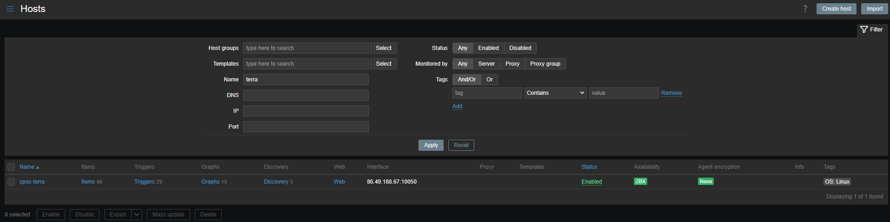

# Zabbix Agent 2 na Debianu 13 (Vagrant)

## Popis projektu
Projekt pomocí Vagrantu spustí virtuální stroj s Debianem 13 a automaticky na něj
nainstaluje Zabbix Agent 2 verze 8.0 LTS z oficiálního repozitáře Zabbixu. Agent se
sám zaregistruje na server `enceladus.pfsense.cz` s hodnotou `HostMetadata=SPOS`
a jedinečným názvem hosta `NAHRAĎTE-SVÝM-NÁZVEM`.

Instalace i konfigurace probíhají výhradně přes provisioning ve `Vagrantfile`,
uvnitř virtuálního stroje se nic neinstaluje ručně.

## Obsah repozitáře
- `Vagrantfile`: definice virtuálního stroje (box `bento/debian-13`) a dvou provisionerů
- `scripts/install-zabbix.sh`: přidá repozitář Zabbix 8.0 pro Debian 13 a nainstaluje `zabbix-agent2`
- `scripts/configure-zabbix.sh`: nastaví `Server`, `ServerActive`, `HostMetadata` a `Hostname` a restartuje agenta
- `Images/`: snímky obrazovky z Zabbixu

## Postup práce
1. **Vagrantfile.** Vyšel jsem ze školní šablony pro Debian 13. Přidal jsem proměnnou
   `ZBX_HOSTNAME` s jedinečným názvem hosta a dva shellové provisionery, které se spustí
   automaticky při prvním startu stroje.
2. **Instalační skript.** Stáhne instalační balíček `zabbix-release` pro verzi 8.0
   a Debian 13, nainstaluje ho příkazem `dpkg -i` (tím se přidá oficiální repozitář
   Zabbixu), aktualizuje seznam balíčků a nainstaluje `zabbix-agent2`. Na konci vypíše
   verzi agenta a zdroj balíčku, aby bylo vidět, že nepochází z výchozího repozitáře
   Debianu. Skript používá `set -euo pipefail`, takže se při první chybě zastaví.
3. **Konfigurační skript.** Pomocí funkce `set_param` zapíše do
   `/etc/zabbix/zabbix_agent2.conf` čtyři parametry:
   - `Server=enceladus.pfsense.cz`
   - `ServerActive=enceladus.pfsense.cz`
   - `HostMetadata=SPOS`
   - `Hostname=<jedinečný název>`

   Funkce existující řádek nahradí, a pokud řádek neexistuje, přidá ho. Skript lze
   proto spustit opakovaně a výsledek je pokaždé stejný. Název hosta je pevně zadaný
   ve `Vagrantfile`, takže se nemění ani po restartu stroje, ani po opakovaném
   provisioningu. Nakonec skript restartuje službu `zabbix-agent2` a vypíše výsledné
   nastavení a stav služby.
4. **Registrace.** Po restartu se agent aktivně připojí k serveru a pošle svůj
   `Hostname` a `HostMetadata`. Server podle metadat `SPOS` použije připravená pravidla
   automatické registrace a host se objeví v Zabbixu.
5. **Ověření.** Zkontroloval jsem verzi agenta, stav služby i konfiguraci uvnitř stroje
   a v Zabbixu pak přiřazenou skupinu, štítek, šablonu a příchozí data.
   Nakonec jsem spustil `vagrant reload --provision` a ověřil, že se název hosta
   nezměnil a nevznikl duplicitní host.

## Jak spustit
```bash
vagrant up
```
Při prvním spuštění se stroj vytvoří a provisionery proběhnou automaticky.
Provisioning lze opakovat příkazem `vagrant provision`.

## Jak ověřit výsledek
Uvnitř virtuálního stroje (`vagrant ssh`):
```bash
zabbix_agent2 --version
systemctl status zabbix-agent2
grep -E '^(Server|ServerActive|HostMetadata|Hostname)=' /etc/zabbix/zabbix_agent2.conf
sudo journalctl -u zabbix-agent2 -n 50
```
V Zabbixu (`enceladus.pfsense.cz`):
- **Data collection → Hosts**: host s mým názvem má přiřazenou skupinu, štítek
  a šablonu pro monitoring Linuxu agentem 2.
- **Monitoring → Latest data**: z hosta přicházejí aktuální data.

## Snímky obrazovky



## Řešené problémy
- Adresa balíčku `zabbix-release` musí obsahovat cestu `/release/`, jinak stahování
  skončí chybou 404.
- Při použití `set -o pipefail` a příkazů s `| head` skript hlásil chybu, i když
  instalace proběhla. Příkazy jsem upravil tak, aby rouru nepoužívaly.
- Skripty musí mít konce řádků ve formátu LF, ne CRLF, jinak je virtuální stroj nespustí.